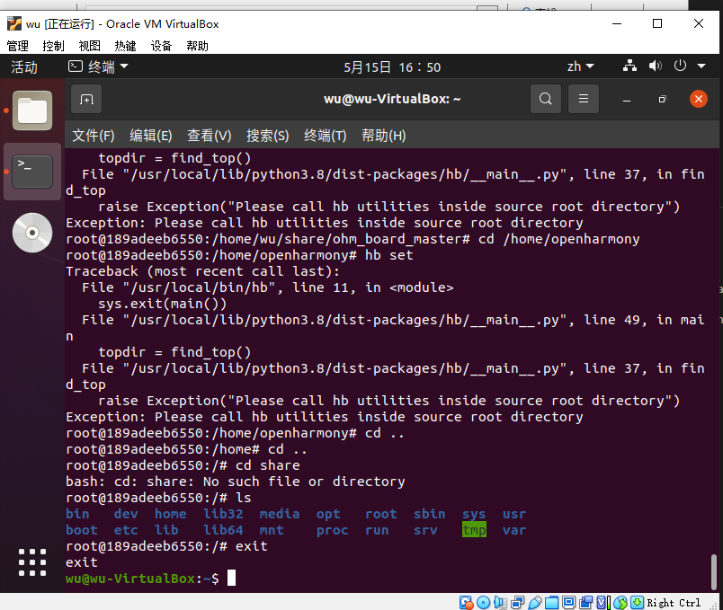
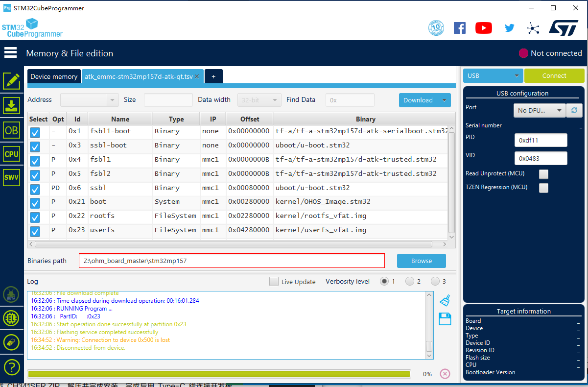
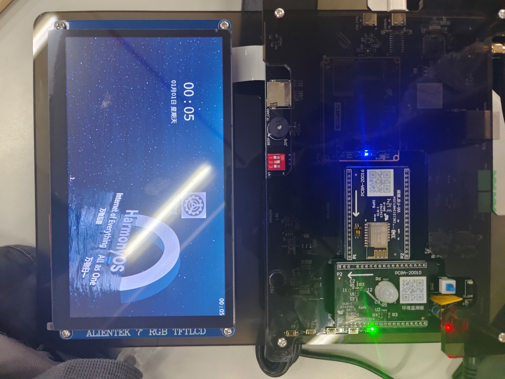

# openharmony-env-setup-guide · OpenHarmony 设备开发环境搭建实录

《嵌入式系统开发》实验六：**从零搭起一套能编译、能烧录、能跑起来的 OpenHarmony 设备开发环境**。
不是"照着教程点下一步"，而是把每一步的真实截图、踩到的坑、排查思路都记下来——
**环境搭建是嵌入式最容易卡住新人的环节，能把它讲清楚本身就值钱。**

## 最终成果

| 环节 | 证据 |
| --- | --- |
| 镜像烧录 | STM32CubeProgrammer 写入 OHOS 系统镜像  |
| 编译环境 | Ubuntu 虚拟机 + Docker 编译环境，`hb` 构建 OpenHarmony  |
| 板子跑起来 | 开发板液晶屏成功启动 OpenHarmony 界面  |

## 环境清单

| 类别 | 内容 |
| --- | --- |
| 宿主机 | Windows（VS Code 编辑 + 烧录） |
| 编译环境 | Ubuntu 虚拟机 + Docker 编译容器 |
| 烧录工具 | STM32CubeProgrammer（`mkimage.stm32` 镜像适配） |
| 目标板 | OpenHarmony 设备开发板 + 液晶显示屏 |
| 其他 | Keil5 / Proteus / STM32CubeMX（课程配套） |

## 搭建流程

```
1. Windows 侧      VS Code 安装配置（代码编辑与工程浏览）
        ↓
2. 烧录工具        STM32CubeProgrammer 安装与驱动配置
        ↓
3. Linux 侧        Ubuntu 虚拟机安装 → 网络设置 → 共享文件夹
        ↓
4. 编译环境        Docker 部署编译容器 → 环境变量配置 → 文件权限调整
        ↓
5. 编译            hb 构建 → mkimage.stm32 生成可烧录镜像
        ↓
6. 烧录与验证      镜像写入开发板 → 液晶屏启动 OpenHarmony 界面
```

## 踩过的坑（最有价值的部分）

| 现象 | 排查 | 根因 | 解决 |
| --- | --- | --- | --- |
| 工具链命令找不到 | 检查 PATH、重启终端 | 环境变量未正确写入 / 未生效 | 规范写入 shell 配置文件并重新加载 |
| 编译报权限错误 | 看报错文件属主、当前用户 | 挂载目录/文件属主不是当前用户 | 修正用户权限与属主 |
| 文件路径相关报错 | 逐条校验脚本里的路径 | Windows 与 Linux 路径格式/大小写混用 | 统一路径写法，避免空格与中文路径 |

> 体会：Linux 环境下的**规范性**和**细节严谨性**是决定成败的关键——
> 绝大多数"玄学报错"最后都是路径、权限、环境变量三件事。

## 面试怎么讲

> 搭过一套完整的 OpenHarmony 交叉编译 + 烧录环境：Windows 编辑、Ubuntu + Docker 编译、
> STM32CubeProgrammer 烧录到开发板并成功启动。
> 过程里踩的主要是路径、权限、环境变量三类问题，我的排查方法是从报错信息反推是哪一类，
> 再逐项校验——这套思路后来在别的嵌入式环境里也通用。

完整问答见 [docs/面试问答.md](docs/面试问答.md)。

## License

MIT
